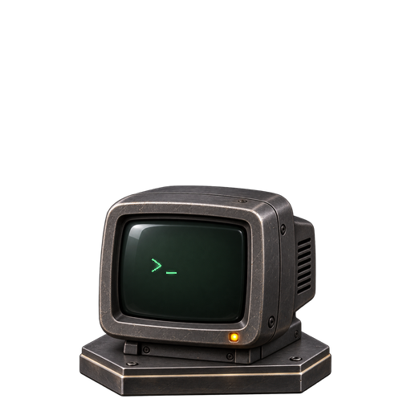
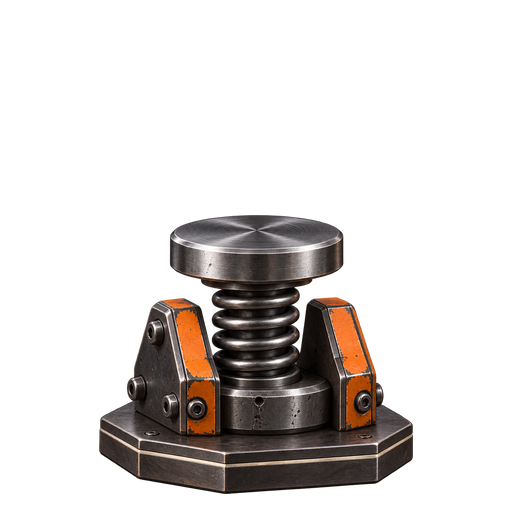
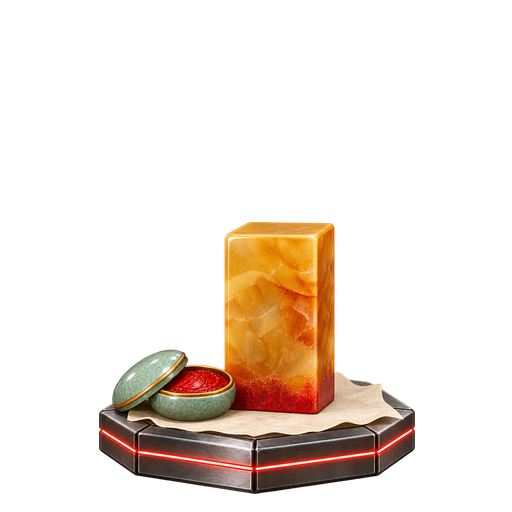
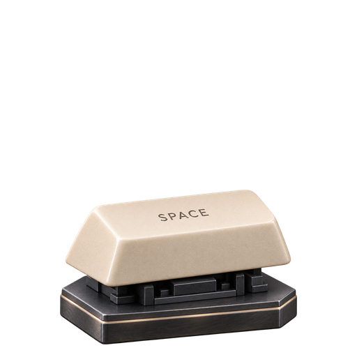

# Plinth Skins

Skins for [Plinth](https://github.com/rubycatco/plinth), the wooden fish on your Mac's desktop, made by the people who knock it. The first six shipped with Plinth itself before they moved here.

## Install a skin

Click **Download** next to a skin, then double-click the `.plinthskin` file, or drop it on the fish. Plinth installs it and switches to it. You need Plinth with `.plinthskin` support.

To get them all at once, download `all-skins.zip` from the [latest release](https://github.com/rubycatco/plinth-skins/releases/latest).

## Gallery

<!-- gallery:start -->
| | Skin | By | Knock | |
| :-: | --- | --- | --- | --- |
|  | **Abacus** · 算盘 | Plinth | `bead` | [Download](https://github.com/rubycatco/plinth-skins/releases/latest/download/abacus.plinthskin) |
|  | **CRT Terminal** · CRT 终端 | Plinth | `crt` | [Download](https://github.com/rubycatco/plinth-skins/releases/latest/download/crt-terminal.plinthskin) |
|  | **Mug** · 马克杯 | Plinth | `ceramic` | [Download](https://github.com/rubycatco/plinth-skins/releases/latest/download/mug.plinthskin) |
|  | **Piston** · 活塞 | Plinth | `piston` | [Download](https://github.com/rubycatco/plinth-skins/releases/latest/download/piston.plinthskin) |
|  | **Seal** · 印章 | Plinth | `stamp` | [Download](https://github.com/rubycatco/plinth-skins/releases/latest/download/seal.plinthskin) |
|  | **Space Key** · 空格键 | Plinth | `key` | [Download](https://github.com/rubycatco/plinth-skins/releases/latest/download/space-key.plinthskin) |
<!-- gallery:end -->

## Add yours

See [CONTRIBUTING.md](CONTRIBUTING.md). In short: one folder in `skins/` with your frames and a `skin.json` that names you and the skin's license, and a pull request.

## License

The scripts are under the [MIT License](LICENSE). Each skin's artwork is under the license named in its `skin.json`.
